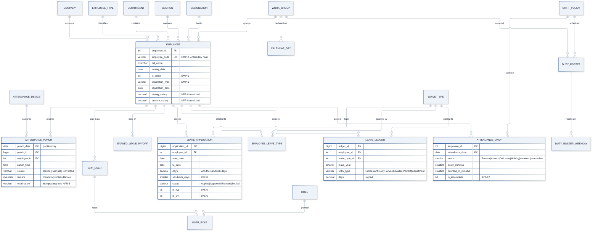
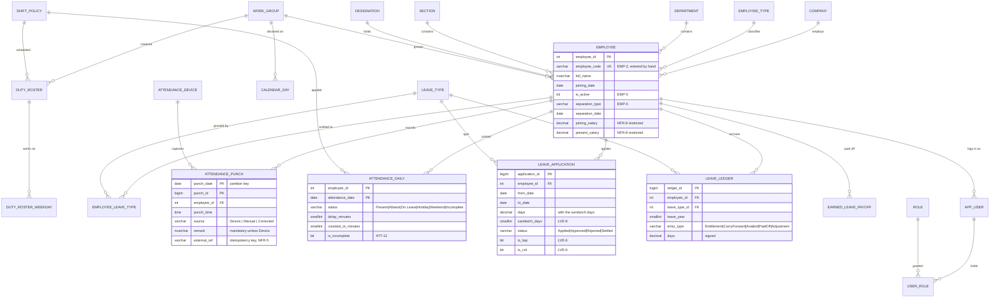

# Hana HRM — database schema (Microsoft SQL Server)

বাংলায় সারাংশ: Angular অ্যাপের হিসাবগুলো MSSQL-এ নিয়ে আসার পুরো schema — ২২টি table, ১৩টি function, ১১টি view, ৭টি procedure, ৫টি trigger, role/column/row level security।
প্রতিটি SRS clause-এর একটি ঠিকানা আছে, এবং calculation engine-টা Angular engine-এর সাথে cross-check করা (৩৩টি assertion, সব pass)।

---

## 1. The files

| File | Content |
| --- | --- |
| `01_schema.sql` | schemas, tables, constraints, indexes, partitioning, temporal tables |
| `02_functions.sql` | the calculation engine — the SRS rules as scalar functions |
| `03_views.sql` | one view per report of the SRS |
| `04_procedures.sql` | the write path — attendance posting, leave workflow, year end, triggers |
| `05_security.sql` | roles, grants, column level security, row level security, session context |
| `06_seed.sql` | the master data and a demo workforce |
| `07_verify.sql` | the SRS worked examples as SQL assertions |
| `verify_with_duckdb.py` | the same assertions executed in a real SQL engine (DuckDB) |

```bash
# apply in this order
sqlcmd -S localhost -U sa -P <password> -d HanaHRM -i 01_schema.sql
sqlcmd -S localhost -U sa -P <password> -d HanaHRM -i 02_functions.sql
sqlcmd -S localhost -U sa -P <password> -d HanaHRM -i 03_views.sql
sqlcmd -S localhost -U sa -P <password> -d HanaHRM -i 04_procedures.sql
sqlcmd -S localhost -U sa -P <password> -d HanaHRM -i 05_security.sql
sqlcmd -S localhost -U sa -P <password> -d HanaHRM -i 06_seed.sql
sqlcmd -S localhost -U sa -P <password> -d HanaHRM -i 07_verify.sql
```

**Requirement:** SQL Server 2019 or later (2016 for `CREATE OR ALTER`). No `LEAST`/`GREATEST`
is used, so the script also runs on 2019.

---

## 2. How the model maps to the Angular application

| TypeScript (src/app/core/models.ts) | SQL table | Note |
| --- | --- | --- |
| `Company` | `hr.company` | |
| `EmployeeType` | `hr.employee_type` | `is_permanent` serves EST-3 |
| `Department`, `Section`, `Designation` | `hr.department`, `hr.section`, `hr.designation` | |
| `WorkGroup` | `hr.work_group` | `group_type` is a CHECK constraint, not a free text |
| `LeaveType` | `hr.leave_type` | annual days, carry forward, calculated flag, attachment flag |
| `ShiftPolicy` | `hr.shift_policy` | `TIME(0)` columns, night shift recognised by the engine |
| `DutyRoster` | `hr.duty_roster` + `hr.duty_roster_weekday` | the working days are normalised |
| `CalendarDay` | `hr.calendar_day` | |
| `Employee` | `hr.employee` | surrogate `employee_id` + the manual `employee_code` of EMP-2 |
| `Employee.leaveTypeIds` | `hr.employee_leave_type` | |
| `Punch` | `hr.attendance_punch` | partitioned by month |
| — | `hr.attendance_daily` | the derived day the reports read |
| `LeaveApplication` | `hr.leave_application` | |
| — | `hr.leave_ledger` | the balance is the sum of the ledger |
| `ElPayoff` | `hr.earned_leave_payoff` | |
| `User` | `app.app_user` + `app.role` + `app.user_role` | the role model of `core/auth.ts` |
| `AuditEntry` | `audit.log_entry` | |
| — | `ops.notification_outbox` | where the mail gateway plugs in |

---

## 3. The entity model





---

## 4. The decisions that matter

### 4.1 The leave balance is a ledger, not a column

A `leave_balance` table with a mutable `days` column is the obvious design and the wrong one:
it loses the history, cannot answer "how did this employee end up with 3 days?", and makes the
year-end carry forward (LVE-3) and the pay-off (ERN-8) a special case.

Instead `hr.leave_ledger` is an append-only book. Every change is an entry with a signed number
of days and a reference to its source document:

| Entry type | Raised by | Effect |
| --- | --- | --- |
| `Entitlement` | `usp_YearEndLeaveProcessing` | the annual days, pro-rated for a mid-year joiner (LVE-4) |
| `CarryForward` | `usp_YearEndLeaveProcessing` | earned leave up to 15 days, never sick or casual (LVE-3) |
| `Availed` | `usp_SettleLeave` | the approved leave, negative (ESS-2) |
| `PaidOff` | `usp_EarnedLeavePayoff` | an earned leave pay-out, negative (ERN-8) |
| `Adjustment` | HR | a manual correction, always with a remark |

The balance is `SUM(days)` per employee, leave type and year — `hr.fn_LeaveBalance`. The unique
constraint on `(employee, type, year, entry_type, reference_type, reference_id)` makes every
posting idempotent: a settlement cannot be posted twice.

### 4.2 The attendance day is materialised

`hr.attendance_daily` holds one row per employee per day with the delay, the overtime, the
status and the highlight flags. A job card over a month is then a single indexed range scan
instead of recomputing the rules for every row of every report.

The rules live in one place — `ops.usp_PostAttendance` — and the same function set that the
Angular application uses. The procedure is re-runnable for any date range and is idempotent:
it deletes and rewrites the range it posts.

### 4.3 Check constraint, trigger or procedure — the decision rule

| Rule | Where it lives | Why |
| --- | --- | --- |
| a manual punch needs a remark (ATT-02) | CHECK constraint | it is a property of a single row, the database refuses the row itself |
| a device record cannot be stored twice (NFR-5) | filtered UNIQUE index | the engine rejects the second insert, the caller does not have to check |
| the group type is Worker or Officer (WRG-2) | CHECK constraint | row level |
| a roster belongs to a group **or** an employee (ROS-2/ROS-4) | CHECK constraint | row level |
| a separation needs a type and a date (EMP-6) | CHECK constraint | row level |
| LWP or CNL needs management approval (LVE-6) | CHECK constraint | row level |
| sick leave needs an attachment (LVE-7) | procedure | the rule is about another table, a CHECK constraint cannot look there |
| a work group has one active roster per period (ROS-3) | trigger | it is a rule about *other* rows; SQL Server has no exclusion constraint |
| the balance is sufficient for the request (LVE-5) | procedure | it is a rule about the sum of the ledger |
| the delay and the overtime (ATT-04 … ATT-10) | functions | they are used by the posting, the views and the reports |

SQL Server has no `EXCLUDE` constraint like PostgreSQL, so the overlapping roster rule
(ROS-3) is a trigger that rolls back and raises — `hr.trg_duty_roster_no_overlap`.

### 4.4 The restricted fields (NFR-8)

Three layers, because one is not enough:

1. **Column level grants** — the application role gets `SELECT` on the employee table column by
   column; the bank and salary columns are only granted to `hr_payroll`. A table level `DENY`
   would override a column level `GRANT`, so the write rights are denied instead.
2. **The views blank the values** — `hr.vw_employee_information` returns
   `CASE WHEN app.fnc_HasPayrollAccess() = 1 THEN e.present_salary END`, so an exported report
   cannot leak a salary even if the caller holds the table permission.
3. **The session context** — the application calls `app.usp_SetSessionContext` once per
   connection; it sets the employee id and the payroll flag. `app.fnc_HasPayrollAccess()` reads
   either the session context or the membership of the payroll role.

### 4.5 Row level security for the self service (NFR-1)

`app.sp_employee_rls` is a security policy on `hr.employee` with the predicate
`app.fnc_OwnsEmployeeRow(employee_id)`. When the session context carries an employee id, that
employee sees only their own row; an HR session (no employee id in the context) sees everything.

### 4.6 The punch table is partitioned

`hr.attendance_punch` is the only table that grows without a bound — roughly 1.5 rows per
employee per day. It is partitioned by month on `punch_date`, with the partition column in the
clustered key as SQL Server requires. A closed month can be archived with a metadata switch
instead of a row-by-row delete, and the reports that scan a date range only touch the
partitions they need.

The monthly boundaries run from 2025-01 to 2027-01. Extend them with
`ALTER PARTITION SCHEME ps_punch_date NEXT USED [PRIMARY];` and a matching
`ALTER PARTITION FUNCTION pf_punch_date SPLIT RANGE (...)` — the empty future partition
catches anything beyond the last boundary.

### 4.7 The employee master is temporal

`hr.employee` has `SYSTEM_VERSIONING = ON`. A job card from last year still shows the name and
the work group that were valid on that day, and every change of the master is in
`hr.employee_history` without an extra trigger.

### 4.8 The audit trail

`audit.log_entry` is written by the triggers (a punch, a calendar change, an employee change,
a pay-off) and by the procedures (a leave application, a decision, a settlement, a report run).
The payroll fields get their own entry type, so a change of a salary is distinguishable from
any other change of the record (NFR-9).

The index on `(occurred_at DESC)` serves the audit screen; the index on `(entity_name,
entity_id, occurred_at DESC)` serves "show me everything that happened to this record".

### 4.9 The device import is idempotent

`ops.usp_SyncDevicePunches` takes a table valued parameter of the device rows. Each row carries
the reference the device gave it, and the filtered unique index on `(device_id, external_ref)`
makes a resend of the same day a no-op (NFR-5). The device can push the whole day again after
a network failure without creating duplicates.

### 4.10 The notification outbox

`ops.notification_outbox` is written in the same transaction as the business change. A mail
gateway reads the pending rows and marks them sent. Nothing is lost if the gateway is down
when a leave is approved, and nothing is sent twice.

---

## 5. Where each SRS clause lives

| Clause | Object |
| --- | --- |
| DSH-1 … DSH-4 | `hr.vw_employee_information`, `hr.vw_work_group_manpower`, `hr.attendance_daily` |
| EMP-2 | `hr.employee.employee_code` + `uq_employee_code` |
| EMP-5 | `hr.employee.is_active` |
| EMP-6 / EMP-9 | `hr.employee.separation_*` + `ck_employee_separation`; deactivation is a separate column |
| EMP-11 | `hr.employee.bank_account_no / joining_salary / present_salary` (restricted) |
| EMT/DPT/SEC/DSG/WRG | the master tables, `ck_work_group_type` for WRG-2 |
| CRD-1 / CRD-2 | `hr.id_card_template`, one row per company |
| SHP-1 … SHP-3 | `hr.shift_policy`, `hr.fn_ShiftSpanMinutes` |
| ROS-1 | `hr.duty_roster_weekday` |
| ROS-3 | `hr.trg_duty_roster_no_overlap` |
| ROS-4 | `hr.fn_ResolveShiftPolicyId` |
| CAL-1 … CAL-6 | `hr.calendar_day`, `hr.fn_DayType`, `hr.trg_calendar_day_audit` |
| ATT-01 | `ops.usp_SyncDevicePunches`, `hr.attendance_device` |
| ATT-02 | `ck_punch_remark` |
| ATT-03 | `hr.attendance_daily.has_manual_entry` |
| ATT-04 / ATT-05 | `hr.fn_DelayMinutes`, `hr.fn_DelayOtAdjustment` |
| ATT-06 / ATT-10 | `hr.fn_DelayMinutes`, `hr.fn_RawOfficerOvertime` (assumption A2) |
| ATT-07 | `hr.attendance_daily.delay_minutes` + the alert in the application layer |
| ATT-08 / ATT-09 | `hr.fn_RawWorkerOvertime`, `hr.fn_RoundOvertime` |
| ATT-11 | `ops.usp_PostAttendance` — the first and the last punch of the day |
| ATT-12 | `hr.attendance_daily.is_incomplete` |
| ATT-13 | `ops.usp_PostAttendance` — the Absent status |
| JOB-1 … JOB-6 | `hr.vw_job_card` |
| EDR-1 … EDR-5 | `hr.vw_daily_attendance` |
| DAR-1 … DAR-6 | `hr.vw_work_group_manpower` |
| DPC-1 … DPC-4 | `hr.vw_punch_count` |
| DLR-1 … DLR-5 | `hr.vw_delay_ratio` |
| EIR-1 … EIR-6 | `hr.vw_employee_information`, `hr.fn_TenureText` |
| EST-1 … EST-6 | `hr.vw_employee_statement` |
| LVE-1 … LVE-8 | `hr.leave_ledger`, `hr.fn_ProRatedEntitlement`, `hr.fn_LeaveDays`, `ops.usp_ApplyLeave` |
| ERN-1 … ERN-8 | `hr.fn_EarnedLeave`, `hr.fn_EarnedLeaveAvailableFrom`, `ops.usp_YearEndLeaveProcessing`, `ops.usp_EarnedLeavePayoff` |
| ESS-2 | `ops.usp_ApplyLeave`, `ops.usp_DecideLeave`, `ops.usp_SettleLeave` |
| ESS-3 | `ops.notification_outbox` |
| NFR-1 | `app.role`, `app.user_role`, `app.sp_employee_rls` |
| NFR-2 / NFR-9 | `audit.log_entry` and the triggers that fill it |
| NFR-3 | `ops.notification_outbox` |
| NFR-4 | the views feed the export service of the application |
| NFR-5 | `ux_punch_device_ref` |
| NFR-7 | one configured time zone in the application, `DATE` and `TIME(0)` columns here |
| NFR-8 | column level grants, `app.fnc_HasPayrollAccess`, the views |

---

## 6. Index strategy

| Index | Serves |
| --- | --- |
| `ix_employee_active_company` (filtered on `is_active = 1`) | the headcount by company and department (DSH-1, EIR-1) |
| `ix_punch_employee_date` | the job card and the attendance posting |
| `ix_punch_date_employee` | the daily report across all employees |
| `ix_attendance_daily_employee_date` | the job card of one employee |
| `ix_attendance_daily_date_status` | the daily report and the manpower summary |
| `ix_leave_app_employee` | the leave history of one employee |
| `ix_leave_app_pending` (filtered on `status = 'Applied'`) | the approval queue |
| `ix_leave_ledger_balance` | the balance of every employee |
| `ix_audit_occurred`, `ix_audit_entity`, `ix_audit_user` | the audit screen |

The filtered indexes keep the index small: only the active employees, only the pending
applications, only the rows with an external reference.

---

## 7. What was verified, and what was not

**Verified**

* every file parses as T-SQL — `sqlfluff lint --dialect tsql` reports **no syntax error**
  across all seven scripts (the only two statements it cannot model are
  `CREATE OR ALTER SECURITY POLICY` and `ALTER TABLE … ENABLE ROW LEVEL SECURITY`, both of
  which are valid SQL Server 2016+ statements);
* the calculation engine was transliterated one to one into DuckDB macros and executed —
  **33 assertions, all pass** — against the same worked examples that
  `npm run verify` checks in the Angular application (`database/verify_with_duckdb.py`);
* the two engines agree on every value, which is the point of the exercise.

**Found and fixed during the verification**

* the T-SQL tenure function used `DATEDIFF` and returned **1848 days** instead of
  `5y 0m 22d`. The cross-check caught it; the function now uses the same calendar component
  arithmetic as the Angular engine.

**Not verified**

* the scripts were **not executed against a live SQL Server**. The sandbox has a 2.87 GB
  cgroup limit; SQL Server 2022 needs about 2 GB for its own startup and failed with
  `Error 701` / `FAIL_PAGE_ALLOCATION` (the container reports only 55 MB of available memory
  and `/proc/sys/vm/drop_caches` is read-only, so the page cache cannot be released).
  Run `07_verify.sql` on a real instance before going to production.

---

## 8. Moving the application from the browser store to the database

The Angular application currently keeps its data in a signal store in `localStorage`
(`src/app/core/store.ts`). The schema is designed so that this store becomes a thin cache
over the API:

| The application does now | The API does |
| --- | --- |
| `store.employees.upsert(...)` | `POST /api/employees` → `hr.employee` |
| `store.punches.all()` | `GET /api/attendance/punches` → `hr.attendance_punch` |
| `attendanceService.dayFor(emp, date)` | `hr.attendance_daily` (already posted) |
| `leaveService.balance(emp, year)` | `hr.fn_LeaveBalance` |
| `leaveService.apply(...)` | `ops.usp_ApplyLeave` |
| `leaveService.decide(...)` / `settle(...)` | `ops.usp_DecideLeave` / `ops.usp_SettleLeave` |
| `store.log(...)` | `audit.log_entry` |

The calculation stays on the server: the browser must not be able to change a rule by
changing a line of JavaScript, and the two engines are already proven to agree.
